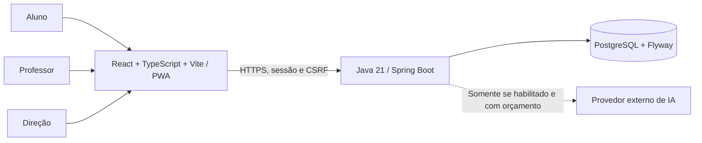

# zELO+ — Relatório de desenvolvimento do Projeto de Extensão

> **Versão para o trabalho acadêmico — 19/11/2026.** Completar identificação da instituição, disciplina, docente, integrantes, local e semestre. Não afirmar implantação institucional antes de um aceite formal.

## Resumo

O zELO+ é o nome de apresentação de uma plataforma escolar responsiva, desenvolvida no âmbito de um **Projeto de Extensão** em Ciência da Computação. A proposta integra, em um mesmo aplicativo, estudos autônomos e um portal de operações escolares para perfis distintos: alunos, professores e direção. O desenvolvimento segue uma abordagem incremental, com protótipos, testes automatizados, revisão do código em pull requests e homologação de usabilidade em desktop e celular. Os registros persistentes no banco de homologação são separados do conteúdo do Laboratório (demo), que **não constitui nota ou frequência oficial**.

**Palavras-chave:** tecnologia educacional; aplicação web progressiva; ensino; experiência do usuário; controle de acesso; desenvolvimento de software.

## 1. Introdução e problema

Alunos, professores e gestores precisam consultar atividades, divulgar orientações, registrar conteúdos e acompanhar a aprendizagem sem perder contexto entre diferentes ferramentas. Uma solução integrada pode reduzir etapas de navegação e facilitar o acesso às informações, desde que preserve o acesso de cada perfil e não apresente simulações como dados reais.

O projeto começou com **três protótipos** (agenda escolar, biblioteca e ferramenta de estudos). A ferramenta de estudos foi escolhida para aprofundamento; sua evolução incorporou o portal escolar com perfis autenticados. A identidade visual provisória adotou o nome **zELO+**, associação de zelo pelo aprendizado com o elo entre comunidade escolar. Nome comercial e registro de marca ainda dependem de verificação.

## 2. Objetivos

**Objetivo geral:** desenvolver e avaliar uma plataforma web responsiva que reúna materiais de estudo e funcionalidades administrativas escolares, com separação de permissões.

**Objetivos específicos:**

1. Construir experiências distintas para aluno, professor e direção.
2. Permitir criação e resposta de atividades persistidas no banco de homologação.
3. Organizar turmas, alunos, disciplinas, horários, comunicados e materiais.
4. Diferenciar conteúdos demonstrativos de registros operacionais.
5. Investigar recursos de apoio pedagógico automatizado com revisão humana.
6. Avaliar usabilidade, segurança básica e comportamento em dispositivos móveis.

## 3. Metodologia

O trabalho adotou **prototipação iterativa** e revisões incrementais: levantamento de dificuldades, comparação de protótipos, definição de jornadas, implementação com React/Java, integração HTTP/JSON, testes automatizados, PRs e homologação manual. Observações reais da experiência do usuário geraram mudanças concretas no login, animação do livro, menu mobile, legibilidade, redução de rolagem, áreas docentes e direção.

A homologação registrada neste relatório é realizada com **contas e dados fictícios**, introduzidos pelas interfaces autorizadas, persistidos no ambiente de testes. Não houve autorização para tratar dados de estudantes reais.

## 4. Arquitetura e tecnologias

| Camada | Tecnologia e função |
| --- | --- |
| Interface | React, TypeScript, Vite; navegação adaptada; PWA |
| Aplicação | Java 21, Spring Boot, validação de requisições e autorização por papel, escola e vínculo |
| Persistência | PostgreSQL; migrações Flyway versionadas |
| Segurança | Sessão via cookie HttpOnly/Secure conforme ambiente, validação CSRF, escopo por escola e turma |
| Hospedagem de homologação | Frontend Vercel; backend Render; banco em staging |
| Engenharia | Git/GitHub, PRs, CI, testes automatizados e roteiros manuais |

**Atenção:** o laboratório de revisão e parte da gamificação armazenam progresso demonstrativo por conta no navegador; isso não equivale a registro de boletim escolar.

## 5. Funcionalidades implementadas

**Aluno:** login; acesso às turmas matriculadas; visualização de atividades publicadas por professores e envio de respostas; explicações recuperáveis; avisos; materiais publicados; painel de desempenho de quizzes; consulta a frequência registrada como **provisória**; biblioteca demonstrativa, revisão e desafios.

**Professor:** acesso somente a turmas/disciplinas vinculadas; publicação de questões de quatro alternativas com gabarito/explicação; edição antes de haver respostas; materiais como rascunho/publicados; registros provisórios de aulas/presença; comunicados e desempenho de atividades.

**Direção:** contas, turmas, matrículas, vínculos docentes, descrição/cor da turma, grade de horários, comunicados e transferência de alunos dentro da mesma escola/ano letivo com histórico de movimentação.

**Assistentes:** respostas guiadas gratuitas (sem modelo generativo) para informações escolares permitidas e tópicos básicos. Há integração preparada para IA generativa de rascunhos e tutor, **desativada sem provedor e orçamento definidos**. Nenhuma nota é atribuída automaticamente pela IA.

## 6. Resultados e evidências

Os entregáveis verificáveis incluem código em repositório, PRs revisáveis, testes automatizados, builds de produção e ambiente de homologação. A aplicação diferencia visualmente o Laboratório (demo) do portal com dados persistidos. A jornada de acesso do aluno passou por revisões com foco em quantidade de rolagem, hierarquia, tamanho de fonte, botão central do livro e navegação por tela pequena.

**Registrar na versão final do trabalho com evidência anexada:** número de testes da CI no commit apresentado; capturas do login mobile/desktop; roteiro de criação da turma; criação de atividade; resposta por aluno; transferência de matrícula; falhas observadas e resolução. Não inventar números de usuários, ganhos de aprendizagem ou resultados de pesquisa sem coleta.

## 7. Limitações e cuidados

- **Não é diário escolar oficial**; faltas e avaliações oficiais ainda dependem de fluxos, validações e governança adicionais.
- **Sem aprovação institucional** para produção com dados de menores.
- Persistência de demo no navegador não se confunde com dados operacionais.
- Recuperação de senha, trilha de auditoria abrangente, backup/restauração comprovados, monitoração, acessibilidade auditada e documentação de privacidade são itens para validação/implementação.
- A IA generativa não está habilitada por padrão e não substitui a análise do professor.
- Disponibilidade do staging não representa SLA de produção.

## 8. Considerações finais

O zELO+ demonstra a aplicação de conceitos de desenvolvimento full stack e design centrado em usuários a uma demanda escolar. O resultado atual é **um protótipo evoluído e piloto de homologação**, não um sistema homologado pelo Estado. Sua evolução para um projeto institucional requer avaliação pedagógica, adesão da escola, evidências de segurança, acessibilidade, privacidade, operação e sustentabilidade.

## 9. Referências e material de apoio

- [Repositório Projeto-Extensao](https://github.com/Ivano-Gabriel/Projeto-Extensao)
- [Documentação local de execução](../COMO_RODAR_LOCAL.md)
- [Roteiro de homologação do zELO+](./HOMOLOGACAO-ZELO.md)
- [Plano de prontidão institucional](./PLANO-INSTITUCIONAL-ZELO.md)
- [Guia da IA pedagógica](./IA-ESCOLAR-ATIVACAO.md)
- [Lei Geral de Proteção de Dados Pessoais — Lei nº 13.709/2018](https://planalto.gov.br/ccivil_03/_ato2015-2018/2018/lei/l13709compilado.htm)
- [Modelo de Acessibilidade em Governo Eletrônico — eMAG](https://www.gov.br/governodigitallogin/pt-br/acessibilidade-e-usuario/acessibilidade-digital/modelo-de-acessibilidade)

**Créditos acadêmicos:** preencher contribuições reais de cada integrante, docentes e estudantes participantes após confirmar autoria e consentimento para citações.
